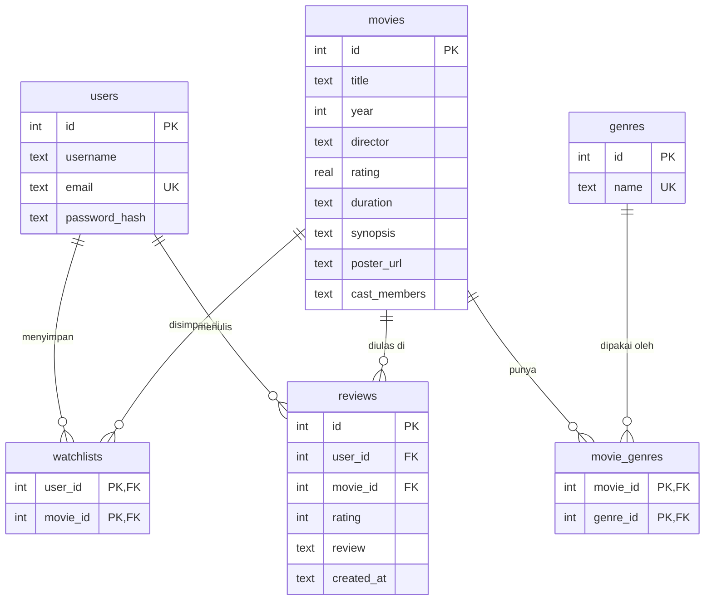

# FilmLog Backend (Movie Watchlist API)

REST API untuk platform watchlist dan review film, dibuat dengan Node.js, Express, dan SQLite.

## Prasyarat

- Node.js 18 atau lebih baru
- API key Gemini gratis dari https://aistudio.google.com

## Cara Menjalankan

1. Masuk ke folder backend dan pasang dependency:
   ```bash
   cd backend
   npm install
   ```

2. Buat file `.env` dari contoh, lalu isi nilainya:
   ```bash
   cp .env.example .env
   ```
   (Di PowerShell: `Copy-Item .env.example .env`)

   | Variabel | Fungsi |
   |---|---|
   | `JWT_SECRET` | Berfungsi sebagai kunci rahasia yang menandatangani dan menverifikasi token. Isi dengan teks acak yang panjang (minimal 32 karakter), misalnya hasil dari perintah node di bawah tabel ini. Sebaiknya jangan dibagikan.|
   | `GEMINI_API_KEY` | Kunci API yang didapatkan dari Google AI Studio (gratis) dan sebaiknya juga jangan sampai ter-commit atau tersebar |
   | `GEMINI_MODEL` | Nama model Gemini. Jika error 404, ganti sesuai daftar model di AI Studio |

     node -e "console.log(require('crypto').randomBytes(32).toString('hex'))"

3. Isi database dengan 20 film awal (**cukup sekali**):
   ```bash
   npm run seed
   ```
   Untuk mengulang, hentikan server, hapus file `filmlog.db`, lalu jalankan seed lagi.

4. Jalankan server:
   ```bash
   npm run dev
   ```
   Server berjalan di `http://localhost:8000`.

5. (Opsional) Buka `frontend/index.html` di browser untuk mencoba lewat antarmuka.

## Desain Database (ERD)

